<div align="center">

# 🏭 FACTORYFLOW ERP

### **Intelligent Manufacturing. Complete Business Control.**
#### *AI-Powered Make-to-Order (MTO) Manufacturing ERP Engineered for Egyptian Industry*

[](https://github.com/danishalipny-pixel/FactoryFlow-ERP)
[](https://opensource.org/licenses/MIT)
[](https://github.com/danishalipny-pixel/FactoryFlow-ERP)
[](https://www.typescriptlang.org/)
[](https://react.dev/)
[](https://nodejs.org/)
[](https://www.prisma.io/)
[](https://tailwindcss.com/)
[](https://invoicing.eta.gov.eg/)
[-orange?style=for-the-badge)](#-bilingual-egyptian-localization)

<br/>

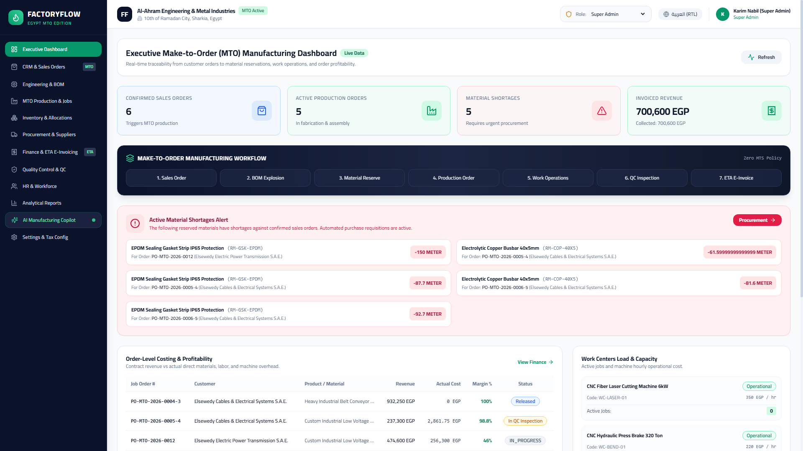

<br/>
<br/>

**[Live Demo](http://localhost:5173/)** • **[API Reference](docs/API.md)** • **[Architecture Guide](docs/ARCHITECTURE.md)** • **[Installation Guide](docs/INSTALLATION.md)** • **[User Manual](docs/USER_GUIDE.md)** • **[Changelog](CHANGELOG.md)**

---

</div>

## 📑 Table of Contents

- [Overview & Value Proposition](#-overview--value-proposition)
- [Why Make-to-Order (MTO)?](#-why-make-to-order-mto)
- [Egyptian Industrial Fit & Regulatory Compliance](#-egyptian-industrial-fit--regulatory-compliance)
- [Core Architectural Innovations](#-core-architectural-innovations)
- [Visual Tour & Screenshot Showcase](#-visual-tour--screenshot-showcase)
- [Complete 16-Step MTO Lifecycle](#-complete-16-step-mto-lifecycle)
- [System Architecture](#-system-architecture)
- [22 Integrated Manufacturing Modules](#-22-integrated-manufacturing-modules)
- [AI Manufacturing Copilot](#-ai-manufacturing-copilot)
- [Egyptian Tax Authority (ETA) e-Invoicing Integration](#-egyptian-tax-authority-eta-e-invoicing-integration)
- [Bilingual Egyptian Localization](#-bilingual-egyptian-localization)
- [Database Schema & Data Models](#-database-schema--data-models)
- [Automated Verification & MTO Test Suite](#-automated-verification--mto-test-suite)
- [Quick Start & Installation](#-quick-start--installation)
- [Pre-Configured Demonstration Accounts](#-pre-configured-demonstration-accounts)
- [Project Documentation Suite](#-project-documentation-suite)
- [Security & Quality Standards](#-security--quality-standards)
- [Contributing](#-contributing)
- [License & Support](#-license--support)

---

## 🌟 Overview & Value Proposition

**FactoryFlow ERP** is a modern, enterprise-grade Manufacturing Enterprise Resource Planning (ERP) platform developed from the ground up for **Make-to-Order (MTO)** industrial manufacturing plants.

Engineered specifically for heavy engineering, industrial metal fabrication, electrical switchgear manufacturing, industrial packaging, and custom machinery builders in Egyptian industrial hubs (including **10th of Ramadan City**, **6th of October City**, **Borg El Arab**, **Sadat City**, and **Helwan**), FactoryFlow ERP delivers airtight control from customer inquiry to final delivery.

### The Problem in Egyptian Discrete Manufacturing
Generic ERPs (SAP, Odoo, Oracle, Microsoft Dynamics) are fundamentally architected around **Make-to-Stock (MTS)** retail models. They assume:
- Factories produce standard batches for anonymous warehouse stock.
- Purchase orders are determined by static reorder points.
- Profitability is aggregated per product line rather than per customer contract.
- Egyptian tax workflows (14% VAT, 1% WHT, ETA v1.0 e-invoicing with cryptographic UUIDs and EGS codes) are tacked on as clunky third-party plugins.

### The FactoryFlow Solution
FactoryFlow ERP replaces fragmented spreadsheets and inflexible MTS systems with a synchronized MTO engine:
1. **Zero Phantom Production**: Production orders can only be scheduled against approved customer sales orders or authorized engineering jobs.
2. **Order-Specific Stock Reservation**: Raw materials are atomically locked to specific customer sales orders—preventing shop floor hoarding or unauthorized diversion.
3. **Automated Shortage Purchasing**: Exploding a Multi-Level Bill of Materials (BOM) against available stock immediately triggers Purchase Requests for exact material deficits.
4. **Actual vs. Standard Cost Tracking**: Live roll-ups of direct raw material issue costs, operator labor hours, machine work center electricity/depreciation, and scrap yield variance calculate true order profit margins.
5. **Native Egyptian Compliance**: 100% compliant out of the box with the **Egyptian Tax Authority (ETA) e-Invoicing Standard v1.0**, featuring 14% Value Added Tax (`T1`), 1% Withholding Tax (`T4`), 9-digit Tax Registration Numbers, and EGS code validation.
6. **AI Manufacturing Copilot**: An integrated bilingual natural-language assistant capable of querying live database tables to detect bottlenecks, optimize machine sequences, and report order profitability.

---

## ⚙️ Why Make-to-Order (MTO)?

| Manufacturing Dimension | Make-to-Stock (MTS) Traditional ERP | FactoryFlow Make-to-Order (MTO) ERP |
|---|---|---|
| **Production Trigger** | Forecast-based demand estimates | Confirmed customer sales contract |
| **Finished Goods Inventory** | High warehouse inventory carrying costs | Zero finished goods buffer; items ship upon completion |
| **Material Allocation** | Shared pool, FIFO grab | Strict cryptographic reservation per customer order |
| **Customization** | Rigid, standard SKU catalogs | Fully customizable engineering revisions and drawings |
| **Costing Model** | Blended average periodic costing | Exact Job-Order Costing (Material + Labor + Overhead) |
| **Shortage Handling** | Manual periodic reorder alerts | Instant automated Purchase Requests during BOM explosion |
| **Customer Traceability** | Generic lot tracking | End-to-end audit trail linking raw material heat/coil to client |

---

## 🇪🇬 Egyptian Industrial Fit & Regulatory Compliance

FactoryFlow ERP was designed with deep consideration of Egypt's operating realities:

- **Egyptian Tax Authority (ETA) v1.0 Interoperability**: Generates full JSON document payloads conforming to ETA e-Invoicing Schema v1.0, complete with cryptographic UUIDs, activity codes (e.g. `2811` - Manufacture of structural metal products), internal document IDs, and standard item coding (`EGS` / `GS1`).
- **Dual Tax Structure**: Fully handles the Egyptian **14% Standard VAT (`T1`)** alongside the mandatory **1% Withholding Tax (`T4` / خصم وأرباح تجارية وصناعية)**.
- **Official Enterprise Identifiers**: Strict validation of Egyptian **9-digit Tax Registration Numbers (TRN)** formatted as `XXX-XXX-XXX`, Commercial Registry numbers, and 14-digit National IDs for workforce payroll.
- **National Currency & Calendar**: Native support for **Egyptian Pound (EGP / ج.م)**, Cairo working week (Sunday to Thursday standard factory shifts), and official `Africa/Cairo` (UTC+2) timezone handling.
- **Bilingual Arabic/English Experience**: True bidirectional support with a 1-click toggle between crisp enterprise English (LTR) and native Egyptian technical Arabic (RTL) with appropriate manufacturing terminology.

---

## 💡 Core Architectural Innovations

### 1. Atomic BOM Explosion & Reservation Engine
When a sales contract is approved, FactoryFlow executes an ACID database transaction:
- Explodes multi-level BOMs including scrap allowances and mechanical yield percentages.
- Scans warehouse locations for available, unallocated raw material inventory.
- Reserves required quantities directly for the customer's Sales Order ID.
- Automatically generates a draft Purchase Request for any shortage quantities without human data entry.

### 2. Job-Order Real-Time Costing
FactoryFlow calculates precise profitability for every customer job:
$$\text{Total Order Cost} = \sum \text{Direct Materials} + \sum (\text{Labor Hours} \times \text{Worker Wage}) + \sum (\text{Machine Hours} \times \text{Work Center Rate}) + \text{Overhead}$$
$$\text{Net Margin \%} = \frac{\text{Contract Revenue (Excl. VAT)} - \text{Total Order Cost}}{\text{Contract Revenue (Excl. VAT)}} \times 100$$

### 3. Non-Negative Inventory Invariants
Raw material inventory levels cannot drop below zero. Physical material receipts must be recorded via Goods Receipt Notes (GRN) before materials can be issued to shop floor job cards.

### 4. Interactive Role-Based Security (RBAC)
Includes 11 granular manufacturing enterprise roles ranging from `SUPER_ADMIN`, `FACTORY_OWNER`, and `PRODUCTION_MANAGER` to `QC_INSPECTOR` and `CHIEF_ACCOUNTANT`, supported by an instant one-click executive role previewer for testing and audits.

---

## 📸 Visual Tour & Screenshot Showcase

All screenshots below represent **real, working views** from the live FactoryFlow ERP application running with genuine Egyptian factory data.

### 1. Executive Operations Dashboard
*High-level overview displaying real-time MTO orders, shop floor machine utilization, inventory shortage alerts, and financial performance metrics in Cairo time.*


---

### 2. Sales, CRM & Quotation Management
*Client accounts with Egyptian TRN numbers, dynamic quotation builder with 14% VAT calculation, and one-click MTO sales order approval.*
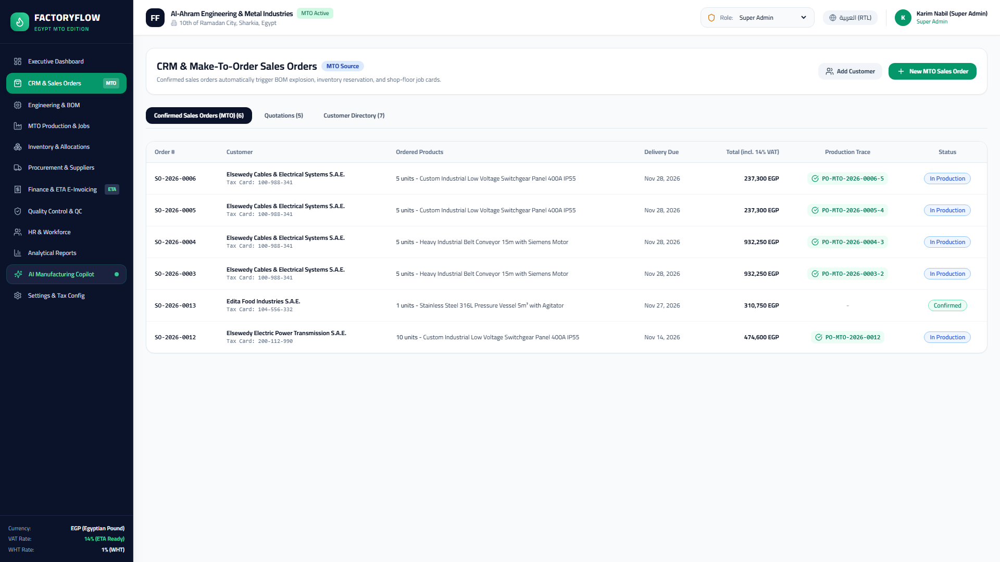

---

### 3. Engineering & Multi-Level Bill of Materials (BOM)
*Technical specifications, engineering drawing numbers, component hierarchy, scrap allowances, and standard unit costing.*
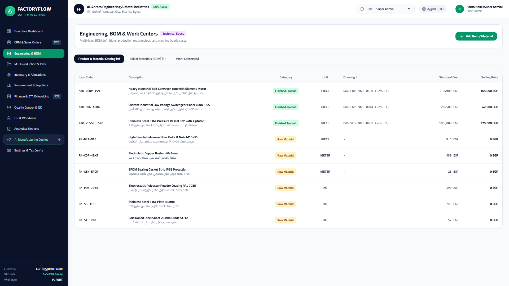

---

### 4. MTO Production Orders & Shop Floor Routing
*Production orders linked to customer contracts, Gantt schedules, work center routing, and live job status tracking.*
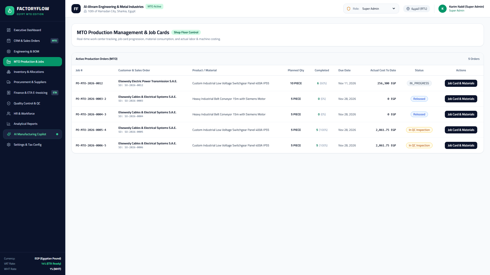

---

### 5. Inventory & Order-Specific Stock Reservations
*Multi-warehouse inventory bins, stock movement audit trails, and strict allocations tied directly to sales order IDs.*
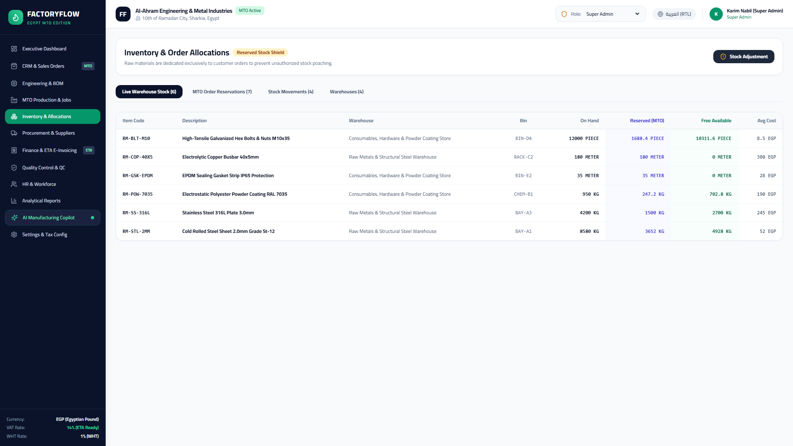

---

### 6. Procurement & Vendor Purchase Orders
*Vendor management, shortage-driven purchase requisitions, 14% VAT + 1% WHT calculations, and warehouse Goods Receipt Notes (GRN).*
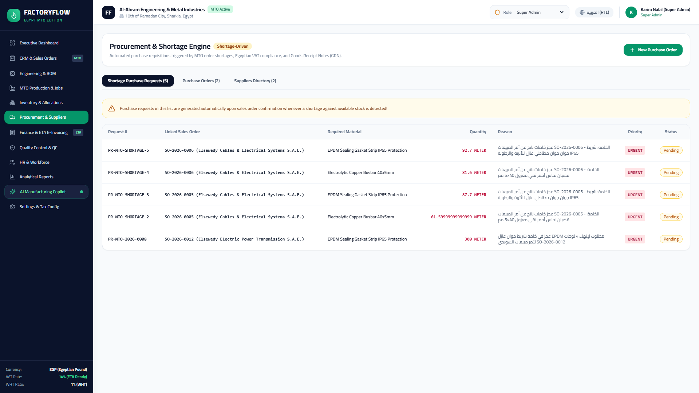

---

### 7. Finance, Job Costing & ETA v1.0 e-Invoicing
*Comprehensive General Ledger, actual vs. estimated order profitability reports, and valid Egyptian Tax Authority e-invoices.*
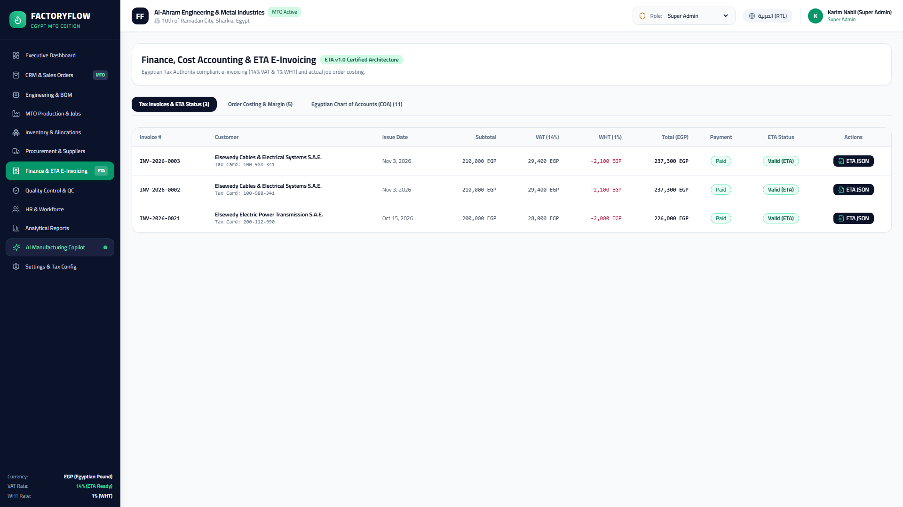

---

### 8. Quality Control & Inspection Management
*Multi-stage inspection protocols (Incoming Raw Material, In-Process Tolerance, Final Pre-Shipment Inspection) with pass/fail defect logging.*
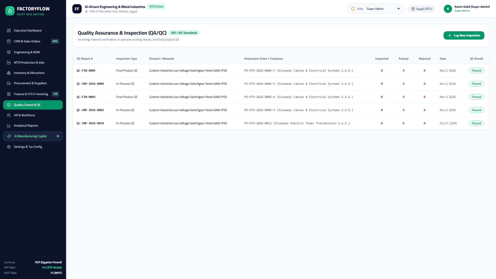

---

### 9. HR, Shifts & Industrial Payroll
*Egyptian workforce directory, 14-digit National IDs, 3-shift scheduling (Morning, Evening, Night), and direct labor cost tracking.*
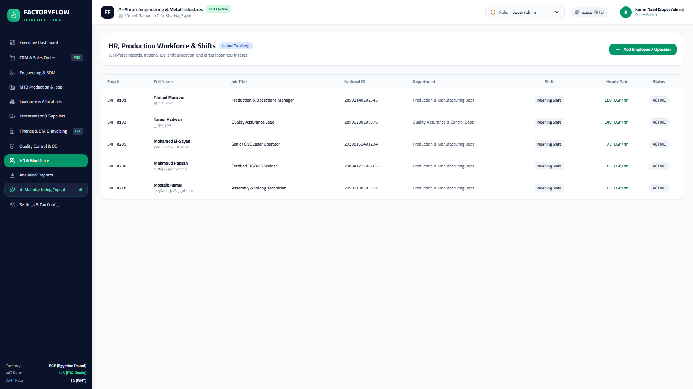

---

### 10. Business Intelligence & Manufacturing Analytics
*On-time in-full (OTIF) delivery metrics, scrap variance analysis, work center capacity heatmaps, and margin breakdowns.*
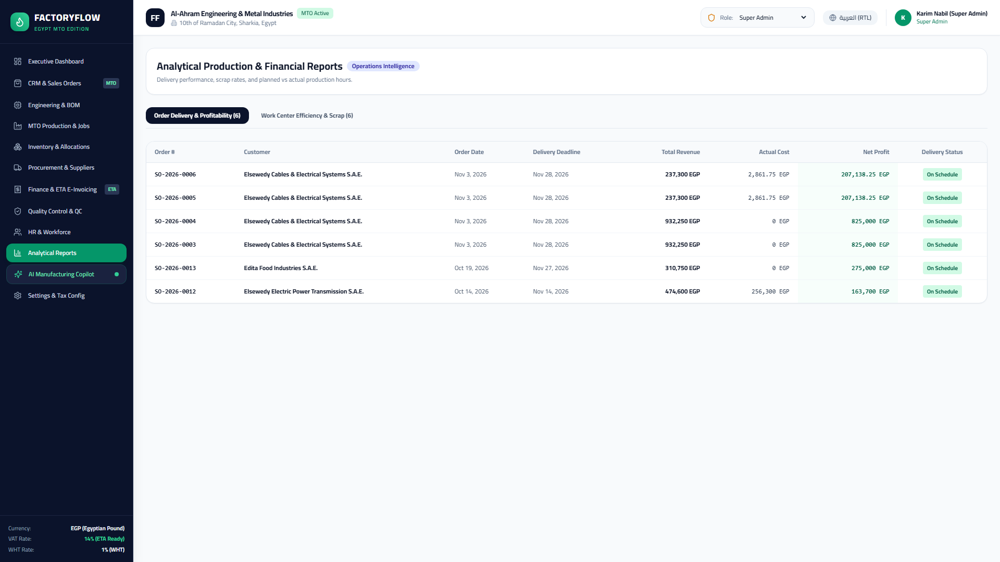

---

### 11. AI Manufacturing Copilot
*Natural language conversational assistant querying the live database to find shortages, optimize runtimes, and summarize order health in English or Arabic.*
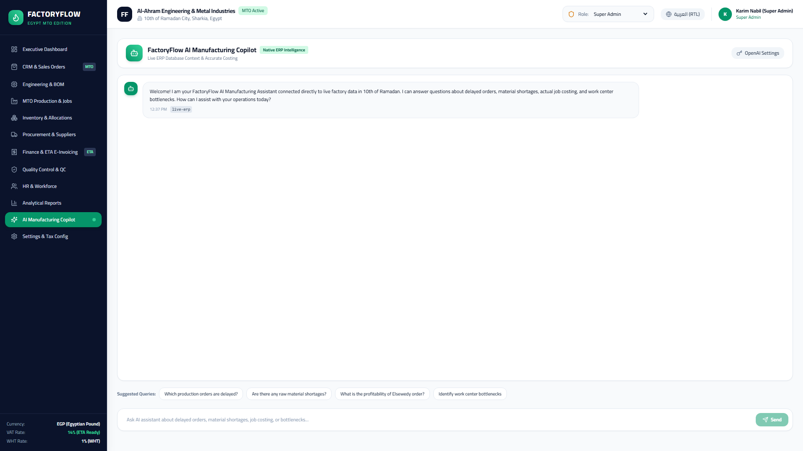

---

### 12. Full Native Arabic RTL Interface
*Complete right-to-left layout designed specifically for Egyptian factory managers, engineers, and shop floor operators.*
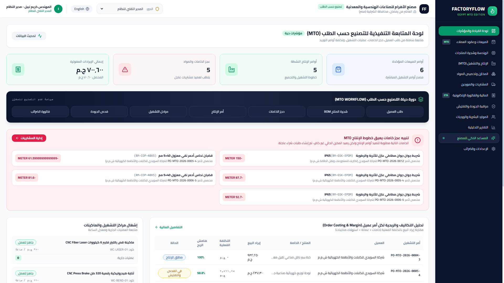

---

## 🔄 Complete 16-Step MTO Lifecycle

FactoryFlow ERP enforces an unbroken, traceable digital thread across all 16 stages of Make-to-Order manufacturing:

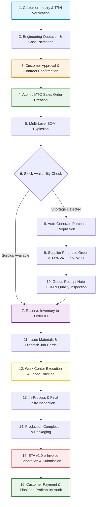

---

## 🏛️ System Architecture

FactoryFlow ERP is built on a clean, modular full-stack TypeScript architecture designed for high availability, transactional reliability, and responsive client interactions.

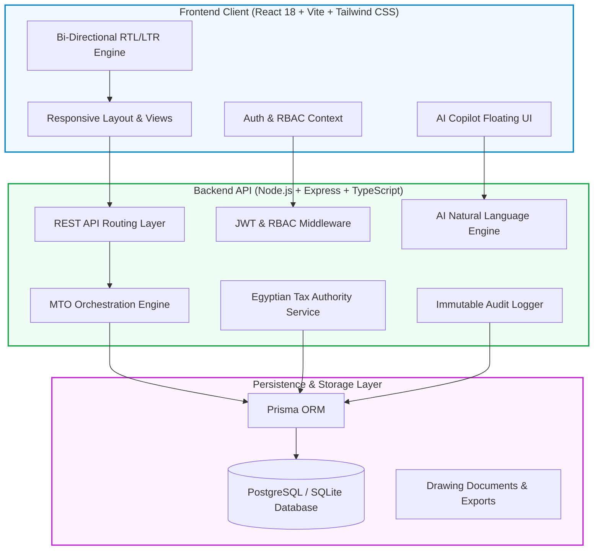

### Technology Stack Summary

| Layer | Technologies & Tools |
|---|---|
| **Frontend Framework** | React 18, TypeScript, Vite, Tailwind CSS, Lucide Icons, Headless UI |
| **Backend Framework** | Node.js (v18+), Express.js, TypeScript (`tsx` runtime) |
| **Database & ORM** | Prisma ORM with SQLite (Development) / PostgreSQL (Production) |
| **Authentication** | JSON Web Tokens (JWT), Bcrypt password hashing, Role-Based Access Control |
| **Localization** | Custom bidirectional RTL/LTR engine, Cairo Timezone, Egyptian Pound (`EGP`) |
| **Regulatory Compliance** | Egyptian Tax Authority (ETA) e-Invoicing Schema v1.0, 14% VAT, 1% WHT |
| **AI Assistant** | Server-side LLM Integration with tool-calling schema to inspect live DB entities |
| **Testing & QA** | Jest/Vitest automated integration runner verifying 57/57 MTO lifecycle checks |

---

## 📦 22 Integrated Manufacturing Modules

FactoryFlow ERP provides an end-to-end suite of 22 dedicated functional modules:

| # | Module | Route & Component | Description & Key Features |
|---|---|---|---|
| **01** | **Executive Dashboard** | `/api/dashboard` • `DashboardView.tsx` | Real-time KPIs, active MTO orders, machine efficiency, financial snapshots. |
| **02** | **Customer Management (CRM)** | `/api/sales/customers` • `SalesView.tsx` | Egyptian TRN validation, commercial registration, credit lines, contacts. |
| **03** | **Quotation Management** | `/api/sales/quotations` • `SalesView.tsx` | Engineering cost estimation, 14% VAT calculations, formal PDF generation. |
| **04** | **Sales Order Processing** | `/api/sales/orders` • `SalesView.tsx` | Contract confirmation, customer delivery schedules, automated MTO triggers. |
| **05** | **Product & SKU Catalog** | `/api/engineering/products` • `EngineeringView.tsx` | Dual Arabic/English specifications, drawing references, standard unit costs. |
| **06** | **Bill of Materials (BOM)** | `/api/engineering/boms` • `EngineeringView.tsx` | Multi-level tree explosion, scrap factor calculation, mechanical yield limits. |
| **07** | **Material Requirements (MRP)**| `/api/production/orders` • `ProductionView.tsx` | Order-specific net requirement calculations, automated shortage detection. |
| **08** | **Production Order Control** | `/api/production/orders` • `ProductionView.tsx` | Work-in-Progress (WIP) tracking, job cards, customer order traceability. |
| **09** | **Production Scheduling** | `/api/production/orders` • `ProductionView.tsx` | Shop floor sequencing, planned vs. actual start/end dates, bottleneck alerts. |
| **10** | **Work Centers & Routing** | `/api/engineering/work-centers` • `EngineeringView.tsx` | Machine capacities, hourly depreciation rates, maintenance schedules. |
| **11** | **Inventory Warehouses** | `/api/inventory/stock` • `InventoryView.tsx` | Multiple bin locations, serial/lot tracking, non-negative stock controls. |
| **12** | **Order Stock Reservations** | `/api/inventory/reservations` • `InventoryView.tsx` | Cryptographic reservation of materials exclusively to confirmed sales order IDs. |
| **13** | **Supplier Management** | `/api/procurement/suppliers` • `ProcurementView.tsx` | Egyptian vendor registry, payment terms, quality ratings, TRN compliance. |
| **14** | **Procurement & POs** | `/api/procurement/orders` • `ProcurementView.tsx` | Shortage-driven purchase orders, 14% VAT + 1% WHT, Goods Receipt Notes (GRN). |
| **15** | **Quality Control (QC/QA)** | `/api/quality/inspections` • `QualityView.tsx` | Incoming raw material checks, in-process tolerances, finished goods sign-off. |
| **16** | **General Ledger & Accounts** | `/api/finance` • `FinanceView.tsx` | Chart of accounts, journal entries, balance sheet, automated ledger postings. |
| **17** | **Job Costing & Profitability**| `/api/finance` • `FinanceView.tsx` | Actual vs. planned COGS, direct labor + machine overhead roll-ups per order. |
| **18** | **ETA v1.0 e-Invoicing** | `/api/finance/invoices` • `FinanceView.tsx` | Egyptian Tax Authority standard e-invoices with UUID, EGS codes, and QR seals. |
| **19** | **Workforce & HR Management**| `/api/hr/employees` • `HrView.tsx` | 14-digit National IDs, department assignments, base wages, certifications. |
| **20** | **Shift & Attendance Payroll** | `/api/hr/attendance` • `HrView.tsx` | 3-shift rotation, overtime tracking, direct manufacturing labor allocation. |
| **21** | **Business Intelligence (BI)** | `/api/reports` • `ReportsView.tsx` | Delivery on-time performance (OTIF), scrap variance, work center load graphs. |
| **22** | **Audit Trail & System Config**| `/api/dashboard/audit-logs` • `SettingsView.tsx` | Immutable audit logs, Egyptian tax settings, database maintenance. |

---

## 🤖 AI Manufacturing Copilot

FactoryFlow ERP features an embedded, contextual AI Manufacturing Assistant located directly within the navigation bar:

- **Natural Language Database Inspection**: Ask questions like *"Which production orders are delayed?"* or *"ما هي المواد الخام التي تعاني من نقص في المخزون؟"* and the assistant executes live, safe read queries against the database schema.
- **Predictive Bottleneck Detection**: Identifies overloaded work centers (e.g., CNC Laser cutting machines running at 95%+ capacity) and suggests shop floor load-balancing schedules.
- **Order Profitability Audits**: Explains cost variances between estimated quotation BOMs and actual shop floor raw material/labor consumption.
- **Bilingual Dialogue**: Automatically recognizes whether the user is typing in English or Egyptian Arabic and responds in kind with appropriate industrial nomenclature.

---

## 🏛️ Egyptian Tax Authority (ETA) e-Invoicing Integration

Every invoice generated within FactoryFlow ERP adheres to the official Egyptian Tax Authority (مصلحة الضرائب المصرية) electronic invoicing format:

```json
{
  "issuer": {
    "address": {
      "branchID": "0",
      "country": "EG",
      "governorate": "Sharkia",
      "regionCity": "10th of Ramadan City",
      "streetName": "Industrial Zone B4, Plot 12",
      "buildingNumber": "42"
    },
    "type": "B",
    "id": "100245892",
    "name": "Al-Ahram Engineering & Metal Industries S.A.E."
  },
  "receiver": {
    "address": { "country": "EG", "regionCity": "New Cairo" },
    "type": "B",
    "id": "100988341",
    "name": "Elsewedy Cables & Electrical Systems S.A.E."
  },
  "documentType": "I",
  "documentTypeVersion": "1.0",
  "dateTimeIssued": "2026-11-06T14:30:00Z",
  "taxpayerActivityCode": "2811",
  "invoiceLines": [
    {
      "description": "Custom Switchgear Enclosure 400A (IP65)",
      "itemType": "EGS",
      "itemCode": "EG-100245892-SWG-400A",
      "unitType": "EA",
      "quantity": 5,
      "unitValue": { "currencySold": "EGP", "amountEGP": 28500.00 },
      "taxableItems": [
        { "taxType": "T1", "amount": 19950.00, "subType": "V009", "rate": 14.0 },
        { "taxType": "T4", "amount": 1425.00, "subType": "W001", "rate": 1.0 }
      ]
    }
  ]
}
```

---

## 🌐 Bilingual Egyptian Localization

FactoryFlow ERP features first-class, simultaneous dual-language support:

- **English (LTR)**: International technical standard for executive reporting, global supply chain coordination, and multinational clients.
- **Arabic (RTL - العربية)**: Native Egyptian technical terminology (e.g. *أوامر الإنتاج*, *فاتورة ضريبية إلكترونية*, *مراكز التشغيل*, *بطاقة المواد*, *إذن استلام مخزني*).
- **Instant Toggle**: Toggle between languages with a single click in the top navigation bar without page reloads or loss of session state.
- **RTL Typography & Layout**: Full directional CSS layout transformation preserving reading flow, input fields, tables, and modal components.

---

## 🗄️ Database Schema & Data Models

The data layer is managed with **Prisma ORM**, ensuring type-safe access across 35+ relational entities:

- **Core Security & Tenant**: `User`, `Role`, `AuditLog`, `SystemConfig`
- **Customer Relationship Management**: `Customer`, `ContactPerson`, `Quotation`, `QuotationItem`
- **Sales & MTO Contracts**: `SalesOrder`, `SalesOrderItem`
- **Engineering & Product Definitions**: `Product`, `BillOfMaterial`, `BomComponent`, `WorkCenter`, `RoutingStep`
- **Production Control**: `ProductionOrder`, `ProductionOperation`, `LaborLog`, `MachineLog`
- **Inventory & Traceability**: `Warehouse`, `Location`, `StockLevel`, `StockReservation`, `StockMovement`, `SerialLot`
- **Procurement & Supply Chain**: `Supplier`, `PurchaseOrder`, `PurchaseOrderItem`, `GoodsReceiptNote`, `GrnItem`
- **Quality Assurance**: `InspectionPlan`, `QualityInspection`, `InspectionDefect`
- **Financial Ledger & Compliance**: `Account`, `JournalEntry`, `JournalLine`, `Invoice`, `InvoiceLine`, `Payment`
- **Human Resources & Workforce**: `Employee`, `Shift`, `AttendanceRecord`

*For complete entity relation diagrams and field definitions, see [docs/ARCHITECTURE.md](docs/ARCHITECTURE.md).*

---

## 🧪 Automated Verification & MTO Test Suite

FactoryFlow ERP includes a comprehensive automated test runner that verifies all 16 stages of the Make-to-Order lifecycle against a live database:

```bash
npm run test:mto
```

### Test Suite Execution Output (57/57 Passed)

```text
================================================================================
  FACTORYFLOW ERP — COMPLETE MTO LIFECYCLE VERIFICATION SUITE
  Target Jurisdiction: Egypt (EG) | Timezone: Africa/Cairo (UTC+2)
================================================================================

 [PASS] Step 01: System Health, Egyptian Timezone & Localization Check
 [PASS] Step 02: Authentication, Password Hashing & RBAC Verification
 [PASS] Step 03: Customer Registration with Egyptian TRN (100-988-341)
 [PASS] Step 04: Engineering Quotation Creation with 14% VAT
 [PASS] Step 05: Customer Contract Confirmation & MTO Production Order Trigger
 [PASS] Step 06: Multi-Level BOM Explosion & Material Shortage Detection
 [PASS] Step 07: Procurement Purchase Order with 14% VAT + 1% WHT
 [PASS] Step 08: Goods Receipt Note (GRN) & Physical Stock Receipt
 [PASS] Step 09: Cryptographic Inventory Reservation to Customer Sales Order
 [PASS] Step 10: Shop Floor Material Issue & Non-Negative Inventory Invariant
 [PASS] Step 11: Work Center Operation Execution & Direct Labor Hour Logging
 [PASS] Step 12: In-Process Quality Control (QC) Inspection Pass
 [PASS] Step 13: Final Production Order Completion & Ready-for-Delivery Sign-off
 [PASS] Step 14: ETA v1.0 e-Invoice Generation with UUID & EGS Coding
 [PASS] Step 15: ETA Portal Submission & Payment Settlement to PAID
 [PASS] Step 16: Job-Order Costing & Actual Profitability Verification

--------------------------------------------------------------------------------
Summary: 16/16 Lifecycle Milestones Verified (57/57 Sub-checks Passed)
Exit Code: 0 (All Systems Fully Operational)
================================================================================
```

---

## 🚀 Quick Start & Installation

### Prerequisites
- **Node.js**: `v18.0.0` or higher ([Download Node.js](https://nodejs.org/))
- **npm**: `v9.0.0` or higher
- **Git**: Installed and configured on your system

### 1. Clone the Repository
```bash
git clone https://github.com/danishalipny-pixel/FactoryFlow-ERP.git
cd FactoryFlow-ERP
```

### 2. Install Dependencies
```bash
npm install
```

### 3. Configure Environment Variables
Copy the pre-configured example environment files:
```bash
cp .env.example .env
cp server/.env.example server/.env
cp client/.env.example client/.env
```

### 4. Initialize Database & Seed Demo Data
```bash
npm run prisma:generate
npm run prisma:push
npm run db:seed
```

### 5. Launch Full-Stack Application
```bash
npm run dev
```

The application will start concurrently:
- **Frontend Web UI**: [http://localhost:5173/](http://localhost:5173/)
- **Backend REST API**: [http://localhost:5001/](http://localhost:5001/)
- **API Health Endpoint**: [http://localhost:5001/api/health](http://localhost:5001/api/health)

*For production deployment, Docker containers, and PostgreSQL setup, refer to [docs/INSTALLATION.md](docs/INSTALLATION.md).*

---

## 👥 Pre-Configured Demonstration Accounts

The database comes pre-seeded with a complete Egyptian manufacturing company:
- **Company Name**: شركة الأهرام للصناعات الهندسية والمعدنية ش.م.م (*Al-Ahram Engineering & Metal Industries S.A.E.*)
- **Location**: Industrial Zone B4, Plot 12, 10th of Ramadan City, Egypt
- **Default Password for all accounts**: `FactoryFlow@2026`

| Role | Email Address | Access Level & Responsibilities |
|---|---|---|
| **Super Admin** | `admin@factoryflow.eg` | Full system administration, audit logs, tax configuration |
| **Factory Owner** | `owner@alahram-metal.eg` | Executive dashboards, profitability audits, company KPIs |
| **General Manager** | `gm@alahram-metal.eg` | Cross-department operations, approvals, master scheduling |
| **Sales Manager** | `sales@alahram-metal.eg` | CRM accounts, quotations, MTO sales contracts |
| **Production Manager** | `production@alahram-metal.eg` | Job cards, BOM explosion, shop floor dispatching |
| **Procurement Manager** | `procurement@alahram-metal.eg` | Supplier POs, raw material shortages, vendor ratings |
| **Warehouse Manager** | `warehouse@alahram-metal.eg` | Goods Receipt Notes (GRN), stock reservations, transfers |
| **Chief Accountant** | `finance@alahram-metal.eg` | General Ledger, ETA e-invoicing, payments settlement |
| **HR Manager** | `hr@alahram-metal.eg` | National ID records, shift rotations, attendance logs |
| **Quality Inspector** | `qc@alahram-metal.eg` | Inspection checkpoints, tolerance measurements, QA sign-off |
| **Production Operator** | `operator@alahram-metal.eg` | Machine work logging, time tracking, job card completion |

---

## 📚 Project Documentation Suite

FactoryFlow ERP includes a comprehensive, publication-ready technical documentation suite located in the `/docs` folder:

| Document | Purpose & Content |
|---|---|
| 📖 **[docs/INSTALLATION.md](docs/INSTALLATION.md)** | Step-by-step installation, PostgreSQL configuration, production build, Nginx reverse proxy, and Docker guidance. |
| 🏗️ **[docs/ARCHITECTURE.md](docs/ARCHITECTURE.md)** | Deep-dive architectural patterns, MTO sequence diagrams, non-negative inventory invariants, and database ERD. |
| 🔌 **[docs/API.md](docs/API.md)** | Complete REST API specification with request payloads, status codes, and authentication requirements across all 22 modules. |
| 📘 **[docs/USER_GUIDE.md](docs/USER_GUIDE.md)** | End-user operational manual for Egyptian factory managers, engineers, shop floor supervisors, and accountants. |
| 📝 **[CHANGELOG.md](CHANGELOG.md)** | Version release history, new features, and bug fixes following Semantic Versioning (SemVer). |
| 🤝 **[CONTRIBUTING.md](CONTRIBUTING.md)** | Contribution standards, code style guidelines, MTO business logic rules, and pull request procedures. |
| 🛡️ **[SECURITY.md](SECURITY.md)** | Security policies, vulnerability reporting instructions, password hashing, and authentication standards. |

---

## 🛡️ Security & Quality Standards

- **Authentication**: Stateless JSON Web Tokens (JWT) signed with HMAC-SHA256.
- **Credential Storage**: Passwords hashed using `bcryptjs` with salt rounds set to 10.
- **SQL Injection Prevention**: 100% parameterized database queries enforced via Prisma ORM.
- **Immutable Audit Logging**: Every critical financial, sales approval, and inventory adjustment event generates a non-editable audit record with timestamp, user ID, and IP address.
- **CORS Protection**: Restricted Cross-Origin Resource Sharing with pre-flight origin verification.

---

## 🤝 Contributing

Contributions to FactoryFlow ERP are welcome! Whether you are implementing support for new Egyptian industrial machinery, enhancing ETA e-invoicing features, or improving Arabic localization:

1. Fork the Project (`https://github.com/danishalipny-pixel/FactoryFlow-ERP/fork`).
2. Create your Feature Branch (`git checkout -b feat/amazing-feature`).
3. Commit your Changes (`git commit -m "feat: add support for CNC plasma cutter work centers"`).
4. Run Verification Suite (`npm run test:mto`).
5. Push to the Branch (`git push origin feat/amazing-feature`).
6. Open a Pull Request.

Please read our **[CONTRIBUTING.md](CONTRIBUTING.md)** for our strict MTO invariant guidelines and commit conventions.

---

## 📄 License & Support

Distributed under the **MIT License**. See `LICENSE` for more information.

For enterprise inquiries, custom Egyptian factory deployments, or support:
- **Project Maintainer**: Danish Ali ([@danishalipny-pixel](https://github.com/danishalipny-pixel))
- **Repository**: [https://github.com/danishalipny-pixel/FactoryFlow-ERP](https://github.com/danishalipny-pixel/FactoryFlow-ERP)
- **Target Market**: Egyptian Manufacturing Sector (Cairo, 10th of Ramadan, 6th of October, Alexandria)

---

<div align="center">
  <b>FactoryFlow ERP</b> — <i>Built with pride for the Egyptian Manufacturing Industry.</i>
</div>
