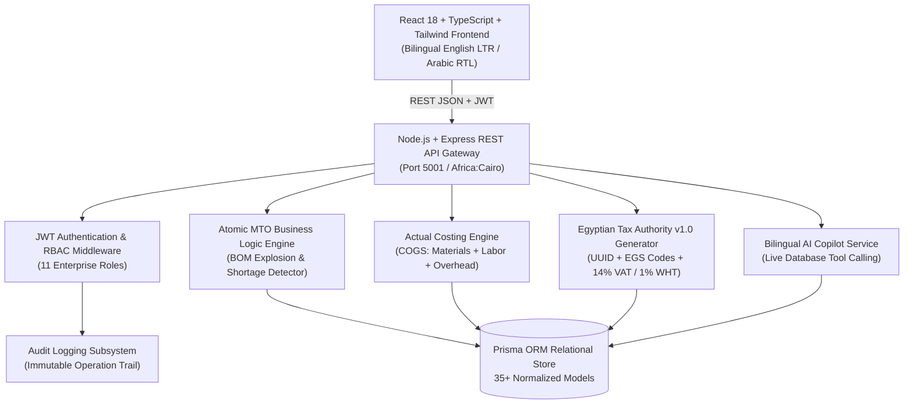
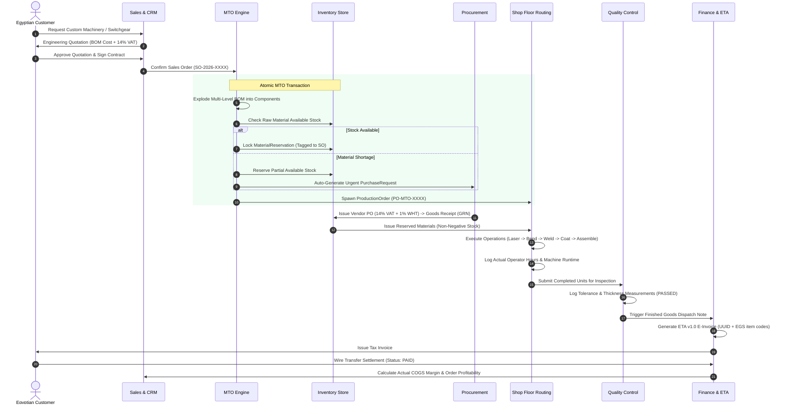

# FactoryFlow ERP — System Architecture & Data Model

This document outlines the architectural principles, domain models, and technical design governing **FactoryFlow ERP**.

---

## 1. Architectural Principles

FactoryFlow ERP is built on five core architectural foundations:

1. **Strict Make-to-Order (MTO) Discipline**:
   - Zero Make-to-Stock speculative production.
   - All production orders (`ProductionOrder`) require an authorized foreign key link to a confirmed sales order (`salesOrderId`).
2. **Order-Specific Inventory Allocation**:
   - Available raw materials are tagged and locked to specific sales orders using `MaterialReservation`.
   - Raw material inventory cannot be poached by competing production orders on the shop floor.
3. **Atomic Transactional Consistency**:
   - Critical manufacturing state transitions (e.g., confirming a sales order, exploding its BOM, checking inventory, locking reserved stock, and emitting shortage purchase requisitions) occur in a single ACID database transaction.
4. **Bilingual Separation of Presentation**:
   - All database models store dual Arabic and English descriptions (`nameAr`, `nameEn`, `jobTitleAr`, `jobTitleEn`).
   - The React frontend strictly separates language states—no mixed or leaking languages.
5. **Egyptian Regulatory Compliance**:
   - Financial models enforce 14% Egyptian VAT (`T1`) and 1% Withholding Tax (`T4` / ضريبة الخصم والإضافة).
   - E-invoicing engine outputs Document Type Version 1.0 JSON with cryptographic UUIDs and EGS item prefix codes (`EG-100245892-...`).

---

## 2. High-Level Architecture Diagram

---

## 3. Make-to-Order (MTO) Manufacturing Lifecycle

---

## 4. Database Schema & Key Entity Relationships

The relational database comprises 35+ normalized models defined in `server/prisma/schema.prisma`:

### Core Domain Entities
- **Company & Factory**: Registered Egyptian entity details (`taxRegistrationNo`, `commercialRegNo`, `activityCode: 2811`, `location`).
- **Customer & Supplier**: Business partner profiles with commercial terms, tax registration, and credit ratings.
- **Product & ProductVariant**: Finished products, sub-assemblies, and raw materials with dual English/Arabic nomenclature and drawing numbers.
- **BOM & BOMItem**: Multi-level engineering bill of materials with scrap allowances and yield rates.
- **Routing & RoutingOperation**: Sequence of work steps linking work centers, labor requirements, setup times, and run times.
- **WorkCenter**: Manufacturing machines with daily capacity, hourly cost rate in EGP, and mechanical efficiency.
- **SalesOrder & SalesOrderItem**: Authorized customer contracts driving production.
- **ProductionOrder & ProductionOperation**: Shop floor job cards capturing actual runtime hours, assigned operators, good output, and scrap.
- **MaterialRequirement & MaterialReservation**: Material allocations tagged directly to customer orders.
- **Inventory, Warehouse & StockMovement**: Non-negative inventory balances and immutable movement history.
- **PurchaseRequest, PurchaseOrder & GoodsReceipt**: Vendor procurement with 14% VAT, 1% WHT, and batch/lot tracking.
- **QualityInspection & QualityDefect**: Incoming, in-process, and final inspection logs with severity ratings.
- **Invoice, InvoiceItem & Payment**: Egyptian statutory invoices, ETA v1.0 JSON payloads with UUIDs, and payment reconciliation.
- **Employee, Department & Attendance**: Workforce profiles with 14-digit Egyptian National IDs, shifts, and wage rates.
- **AuditLog**: Immutable system audit trail capturing user identity, action type, resource ID, and operational details.
